# `@freefades2black/card` — Interactive Cyberpunk Terminal Card & Resume Hub

<p align="center">
  
</p>

Interactive Cyberpunk Terminal Business Card & Resume Hub for **William Free Hall (`FreeFades2Black`)** — Solutions Architect, Cloud/Data Engineer & U.S. Army Special Forces Veteran (`18Z / 18F`, 23 years active duty).

🌐 **Live NFC / Mobile / Browser Interactive Terminal:**  
👉 **[https://freefades2black.github.io/freefades2black-card/](https://freefades2black.github.io/freefades2black-card/)**

---

## ⚡ Run Instantly in Any Terminal (Zero Install / Zero Config)

```bash
# Universal npx runner (launches interactive arrow-key menu in terminal)
npx github:FreeFades2Black/freefades2black-card

# Machine-readable JSON output
npx github:FreeFades2Black/freefades2black-card --json

# Instant ANSI stream (works even without Node.js installed)
curl -sL https://freefades2black.github.io/freefades2black-card/card.ans
irm https://freefades2black.github.io/freefades2black-card/card.ans
```

---

## 🧭 Interactive Menu Options

When executed in an interactive terminal (`npx github:FreeFades2Black/freefades2black-card`), use the `↑`/`↓` arrow keys or number keys `1`–`6` to explore:

```text
? What would you like to explore? (Use ↑/↓ arrows or keys 1-6, Enter to select, 0/q to exit)
❯ 1. Core Competencies & Cloud Architecture
  2. Experience & Leadership History
  3. Live Projects & GitHub Repos (Open Browser)
  4. Certifications & Credentials
  5. Open Interactive Web Portfolio (Open Browser)
  6. Direct Contact & LinkedIn (Open Browser)
  0. Exit
```

---

## 📲 Ready-to-Use Sharing Snippets

### 1. Physical NFC Card Target URL
Program your NFC tag to open:
```text
https://freefades2black.github.io/freefades2black-card/
```

### 2. LinkedIn Featured / About Banner
> Skip the PDF resume. Inspect my architecture portfolio live in your shell:  
> `npx github:FreeFades2Black/freefades2black-card`  
> Or in your browser: https://freefades2black.github.io/freefades2black-card/

### 3. Email Signature & Cover Note Hook
```text
Free Hall | Solutions Architect & Cloud/Data Engineer
Terminal Card: npx github:FreeFades2Black/freefades2black-card
Web Terminal:  https://freefades2black.github.io/freefades2black-card/
```
